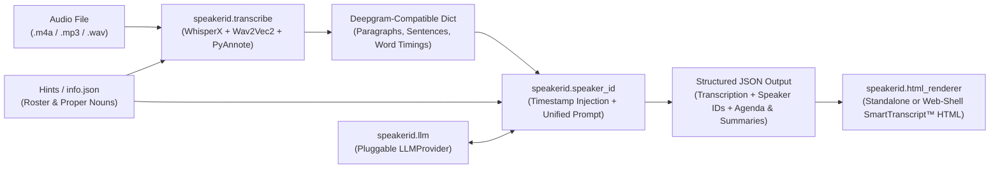

# `speakerid` — Local GPU & Pluggable LLM Generator for SmartTranscripts™ (`tevslin/speakerid`)

> **DUAL-USE REPOSITORY SPECIFICATION (FOR AI AGENTS & HUMAN DEVELOPERS)**
> This repository and README were **created by Google Gemini** (pair-programming with Tom Evslin) and are designed to be ingested by **autonomous AI coding agents** (Gemini, Claude Code, Antigravity, Cursor, Codex, etc.) while remaining clear and accessible for **human developers**.
> - **AI Agents**: Follow the deterministic, OS-specific bootstrap commands in [Section 1](#1-one-step-assembly--installation-windows-pc-macos-linux) and the machine-readable schemas in [Section 5](#5-machine-readable-contracts--data-schemas-llm-reference) to assemble, configure, and execute `speakerid` on the user's machine.
> - **Humans**: See [What is a SmartTranscript™?](#what-is-a-smarttranscript) below, then jump to [Section 1](#1-one-step-assembly--installation-windows-pc-macos-linux) for copy-paste setup on **Windows PC**, **macOS**, or **Linux**, and [Section 2](#2-running-speakerid-cli--python-api) for CLI and Python API usage.

---

## What is a SmartTranscript™?

**`speakerid`** produces **SmartTranscripts™** from arbitrary audio or video recordings (`.m4a`, `.mp3`, `.wav`, `.mp4`, etc.).

Unlike a conventional raw transcript, a **SmartTranscript™** combines four synchronized layers in a single verifiable package (output as structured JSON, an interactive HTML viewer, or both):
1. **Precision Timestamped Text**: Every sentence and word is phonetically aligned to the underlying audio/video so clicking or selecting any text immediately cues and plays the exact clip.
2. **Real-Name Speaker Identification (`speakerid`)**: Generic diarization labels (`[Speaker 0]`, `[Speaker 1]`, ...) are automatically resolved to real people's names and titles using roll calls, introductions, direct address, and optional roster hints—including **time-bound speaker overrides** when speakers overlap or trade turns within a single diarization cluster.
3. **Derived Timestamped Agenda**: Long recordings are automatically segmented into navigable chapters ($\le 15$ minutes each) linked to the exact second each topic begins.
4. **Topic Summaries**: Every derived agenda chapter includes a concise, neutral summary of what was discussed, with the opening summary also serving as the document's OpenGraph/metadata summary.

### Live Production Example & Relationship to Earlier Repositories
* **[goldendomevt.com](https://goldendomevt.com)** is a live production site built with **SmartTranscripts™**, providing verifiable, video-linked transcripts of floor and committee meetings of the Vermont Legislature.
* **Updated & Improved Transcription Engine**: The transcription, alignment, diarization, and speaker-identification code in this repository (`tevslin/speakerid`) is **later and better** than the earlier transcription code in [`tevslin/smarttranscripts`](https://github.com/tevslin/smarttranscripts) and [`tevslin/goldendomevt`](https://github.com/tevslin/goldendomevt). Specifically, `speakerid` introduces:
  * Local GPU **WhisperX (`faster-whisper` large-v3)** with custom decoding tuning, proper-noun prompt sanitization/token-truncation, **Wav2Vec2** phonetic alignment, and **PyAnnote 3.1** speaker diarization.
  * **Time-bound speaker overlap overrides** (handling mid-meeting speaker handoffs and crosstalk).
  * **A localized, pluggable LLM architecture (`speakerid.llm`)** that removes cloud/vendor lock-in so you can substitute any local LLM (Ollama, vLLM, LM Studio, `llama.cpp`) or remote LLM (Gemini, OpenAI, Anthropic, LiteLLM).

### Hardware Acceleration Matrix

| Operating System | Hardware | `--device auto` Behavior (Default) |
| :--- | :--- | :--- |
| **Windows PC** | NVIDIA GPU (CUDA 12.x) | Uses `cuda` (`float16`) for WhisperX ASR, Wav2Vec2 alignment, and PyAnnote diarization. |
| **Linux** | NVIDIA GPU (CUDA 12.x) | Uses `cuda` (`float16`) for WhisperX ASR, Wav2Vec2 alignment, and PyAnnote diarization. |
| **macOS** | Apple Silicon (M1/M2/M3/M4) | Uses `cpu` (`int8`) for CTranslate2 ASR and Apple Metal (`mps`) for PyTorch alignment & diarization. |
| **Any OS** | CPU-only | Automatically falls back to `cpu` (`int8`). |

---

## 1. One-Step Assembly & Installation (Windows PC, macOS, Linux)

### Prerequisite A: Hugging Face Token (Required once for PyAnnote Speaker Diarization)
PyAnnote's speaker diarization model weights are hosted on Hugging Face behind a free license click-through:
1. Create a free read token at: `https://huggingface.co/settings/tokens`
2. Click **"Agree and access repository"** on both model pages while logged in:
   - `https://huggingface.co/pyannote/speaker-diarization-3.1`
   - `https://huggingface.co/pyannote/segmentation-3.0`

---

### Option 1A: Windows PC (PowerShell — NVIDIA GPU or CPU)

```powershell
# 1. Install FFmpeg (skip if `ffmpeg -version` already works)
winget install Gyan.FFmpeg

# 2. Clone repository and create virtual environment (Python 3.10 - 3.12 recommended)
git clone https://github.com/tevslin/speakerid.git
cd speakerid
python -m venv .venv
.\.venv\Scripts\Activate.ps1

# 3. Install PyTorch (CUDA 12.8), WhisperX, PyAnnote, and speakerid
# Note: requirements.txt includes `--extra-index-url https://download.pytorch.org/whl/cu128`
# and pins matching torch==2.8.0 / torchaudio==2.8.0 / torchvision==0.23.0 wheels
pip install --upgrade pip
pip install -r requirements.txt
pip install -e .

# 4. Fill in your tokens/passwords in .env
# Edit the included .env file and replace the dummy placeholder values (HF_TOKEN, etc.) with your real credentials
```

---

### Option 1B: macOS (Apple Silicon M1/M2/M3/M4 or Intel)

```bash
# 1. Install FFmpeg via Homebrew (skip if `ffmpeg -version` already works)
brew install ffmpeg

# 2. Clone repository and create virtual environment
git clone https://github.com/tevslin/speakerid.git
cd speakerid
python3 -m venv .venv
source .venv/bin/activate

# 3. Install PyTorch, WhisperX, PyAnnote, and speakerid
pip install --upgrade pip
pip install -r requirements.txt
pip install -e .

# 4. Fill in your tokens/passwords in .env
# Edit the included .env file and replace the dummy placeholder values (HF_TOKEN, etc.) with your real credentials
```

---

### Option 1C: Linux (Ubuntu / Debian — NVIDIA GPU or CPU)

```bash
# 1. Install FFmpeg and Git
sudo apt-get update && sudo apt-get install -y ffmpeg git python3-venv

# 2. Clone repository and create virtual environment
git clone https://github.com/tevslin/speakerid.git
cd speakerid
python3 -m venv .venv
source .venv/bin/activate

# 3. Install PyTorch (CUDA 12.8) + WhisperX + PyAnnote + speakerid
pip install --upgrade pip
pip install -r requirements.txt
pip install -e .

# 4. Fill in your tokens/passwords in .env
# Edit the included .env file and replace the dummy placeholder values (HF_TOKEN, etc.) with your real credentials
```

---

### Option 1D: Docker (Linux / Windows WSL2 with NVIDIA Container Toolkit)

```bash
git clone https://github.com/tevslin/speakerid.git
cd speakerid

# Build container
docker build -t speakerid .

# Run on an audio file in the current directory using GPU passthrough
docker run --rm --gpus all \
  -e HF_TOKEN="hf_your_token" \
  -e LLM_PROVIDER="ollama" \
  -e LLM_BASE_URL="http://host.docker.internal:11434" \
  -e LLM_MODEL="llama3.3" \
  -v "$(pwd):/workspace" \
  speakerid /workspace/audio.m4a \
  --hints /workspace/examples/sample_info.json \
  -o /workspace/transcript.json \
  --html /workspace/transcript.html
```

---

## 2. Running `speakerid` (CLI & Python API)

You can generate **structured JSON** (`-o`), **interactive HTML** (`--html`), or **both**.
*(If neither `-o` nor `--html` is specified, both `<audio_stem>_smarttranscript.json` and `<audio_stem>_smarttranscript.html` are written automatically.)*

### A. Command-Line Interface (CLI)

#### 1. Local LLM via Ollama (`ollama`)
```bash
# Start Ollama locally and pull a model (e.g., `ollama pull llama3.3` or `ollama pull qwen2.5:32b`)
speakerid audio.m4a \
  --hints examples/sample_info.json \
  --llm-provider ollama \
  --llm-model llama3.3 \
  -o transcript.json \
  --html transcript.html
```

#### 2. Local vLLM / LM Studio / `llama.cpp` Server (`openai`)
```bash
speakerid audio.m4a \
  --hints examples/sample_info.json \
  --llm-provider openai \
  --llm-base-url http://localhost:8000/v1 \
  --llm-model Qwen/Qwen2.5-32B-Instruct \
  -o transcript.json \
  --html transcript.html
```

#### 3. Remote Cloud LLM (Google Gemini, OpenAI, or Anthropic)
```bash
# Set GEMINI_API_KEY, OPENAI_API_KEY, or ANTHROPIC_API_KEY in .env or environment
speakerid audio.m4a \
  --hints examples/sample_info.json \
  --llm-provider gemini \
  --llm-model gemini-2.5-flash \
  -o transcript.json \
  --html transcript.html
```

#### 4. Re-Run Only the LLM / HTML Step on an Already-Transcribed JSON File
Skip the GPU WhisperX step and test a different LLM or regenerate the HTML viewer in seconds:
```bash
speakerid --from-json transcript.json \
  --hints examples/sample_info.json \
  --llm-provider ollama \
  --llm-model qwen2.5:32b \
  --html transcript_qwen.html
```

---

### B. Simple Python API

```python
from speakerid import create_smart_transcript, LLMConfig

# 1. Configure any local or remote LLM
llm_cfg = LLMConfig(
    provider="ollama",                  # "ollama", "openai", "vllm", "lmstudio", "llamacpp", "gemini", "anthropic", "litellm"
    model="llama3.3",                   # model identifier
    base_url="http://localhost:11434",  # optional custom endpoint URL
)

# 2. Run the full pipeline (ASR + Alignment + Diarization + Speaker ID + Derived Agenda/Summaries + JSON/HTML)
result = create_smart_transcript(
    audio_path="audio.m4a",             # or omit audio_path and pass precomputed_transcription="transcript.json" to skip GPU ASR
    hints="examples/sample_info.json",  # optional path to info.json, .txt, dict, or raw hint string
    output_json_path="transcript.json", # optional: write structured JSON
    output_html_path="transcript.html", # optional: write interactive SmartTranscript™ HTML viewer
    llm_config=llm_cfg,
    device="auto",                      # "auto" (CUDA -> MPS -> CPU), "cuda", "mps", or "cpu"
)

print("Speakers:", result.speaker_id_analysis["speakers"])
print("Agenda & Summaries:", result.speaker_id_analysis["agenda_items"])
```

---

## 3. Substituting Any Custom Local or Remote LLM

All LLM dependencies are strictly isolated inside [`speakerid/llm.py`](speakerid/llm.py). No other file in the repository imports an LLM SDK.

### Built-In Providers (Zero Code Changes)
| `--llm-provider` | Default `--llm-base-url` | Environment Variable for Key | Notes |
| :--- | :--- | :--- | :--- |
| `ollama` | `http://localhost:11434` | *(None required)* | Calls Ollama native `/api/chat` with `format: "json"`. |
| `openai` | `https://api.openai.com/v1` | `OPENAI_API_KEY` | Works with OpenAI or any OpenAI-compatible server. |
| `vllm` | `http://localhost:8000/v1` | *(Optional)* | Local vLLM OpenAI-compatible server. |
| `lmstudio` | `http://localhost:1234/v1` | *(None required)* | Local LM Studio server. |
| `llamacpp` | `http://localhost:8080/v1` | *(None required)* | Local `llama-server` (`llama.cpp`). |
| `gemini` | Google Generative Language API | `GEMINI_API_KEY` or `GOOGLE_API_KEY` | Uses `google-genai` SDK if installed, or zero-dependency REST fallback. |
| `anthropic` | `https://api.anthropic.com/v1` | `ANTHROPIC_API_KEY` | Calls Claude `/v1/messages` via standard library HTTP. |
| `litellm` | *(Managed by LiteLLM)* | *(Provider-specific)* | Routes to 100+ providers via `litellm.completion()`. |

### Custom Python `LLMProvider` Subclass
If you want to run in-process Python weights (e.g., `transformers`, `llama-cpp-python`, `mlx-lm` on Mac) or a proprietary internal API, subclass `LLMProvider` and implement `generate_json(prompt, system_prompt) -> dict`:

```python
from speakerid import create_smart_transcript, LLMProvider
from speakerid.llm import extract_json_from_text

class MyCustomLLM(LLMProvider):
    def generate_json(self, prompt: str, system_prompt: str = "") -> dict:
        raw_text = my_custom_model_call(system=system_prompt, user=prompt)
        return extract_json_from_text(raw_text)

create_smart_transcript(
    audio_path="audio.m4a",
    output_json_path="transcript.json",
    output_html_path="transcript.html",
    llm_provider=MyCustomLLM(),
)
```

---

## 4. Repository Architecture & Bill of Materials (BoM)



| File Path | Module Purpose (BoM) | Primary Entrypoints / Classes |
| :--- | :--- | :--- |
| [`speakerid/__init__.py`](speakerid/__init__.py) | Package exports for Python API consumers. | `create_smart_transcript`, `transcribe_and_diarize`, `identify_speakers_and_agenda`, `LLMConfig`, `LLMProvider` |
| [`speakerid/cli.py`](speakerid/cli.py) | CLI argument parser and entrypoint (`speakerid`). | `main()`, `run_cli()`, `build_arg_parser()` |
| [`speakerid/pipeline.py`](speakerid/pipeline.py) | High-level orchestrator connecting transcription, LLM analysis, and file outputs. | `create_smart_transcript()`, `load_dotenv_if_present()` |
| [`speakerid/transcribe.py`](speakerid/transcribe.py) | WhisperX ASR, Wav2Vec2 alignment, PyAnnote diarization, cross-platform device resolution (`cuda`/`mps`/`cpu`), and Deepgram schema mapping. | `transcribe_and_diarize()`, `transcribe_audio_raw()`, `resolve_compute_device_and_type()`, `map_to_deepgram_response()` |
| [`speakerid/llm.py`](speakerid/llm.py) | Localized pluggable LLM adapter with zero external SDK lock-in. | `LLMProvider`, `LLMConfig`, `create_llm_provider()`, `OpenAICompatibleProvider`, `OllamaProvider`, `GeminiProvider`, `AnthropicProvider`, `LiteLLMProvider` |
| [`speakerid/speaker_id.py`](speakerid/speaker_id.py) | Sentence timestamp injection (`[123.45]`), legislative-aide prompt builder, hints parser, and time-bound speaker override resolver. | `identify_speakers_and_agenda()`, `parse_hints_input()`, `process_deepgram_output()`, `resolve_speaker_mappings()` |
| [`speakerid/html_renderer.py`](speakerid/html_renderer.py) | Renders either a single-file standalone HTML SmartTranscript™ viewer or the multi-file web shell (`templates/viewer_template.html` + `assets/`). | `render_smart_transcript_html()`, `build_transcript_and_agenda_fragments()` |
| [`speakerid/schemas.py`](speakerid/schemas.py) | Pydantic v2 schemas for Deepgram v1 responses, speaker mappings, agenda chapters, and pipeline outputs. | `DeepgramResponse`, `SpeakerIdentificationResult`, `SmartTranscriptOutput` |
| [`examples/sample_info.json`](examples/sample_info.json) | Example committee/meeting metadata and proper-noun hints file. | JSON configuration |
| [`examples/example_api_usage.py`](examples/example_api_usage.py) | Runnable Python API example including custom `LLMProvider` demonstration. | `run_with_configured_llm()`, `CustomLocalLLM` |
| [`tests/test_pipeline.py`](tests/test_pipeline.py) | Unit and integration test suite using a deterministic mock LLM and synthetic WhisperX segments. | `TestSpeakerIdPipeline` |

---

## 5. Machine-Readable Contracts & Data Schemas (LLM Reference)

### A. Input Hints Schema (`--hints info.json` or `dict`)
Providing a hints file is optional but improves both WhisperX proper-noun recognition (`initial_prompt`) and LLM speaker attribution:
```json
{
  "title": "Senate Transportation - 2026-04-10 - 10:40AM",
  "video_url": "https://www.youtube.com/watch?v=T8uEA-lphcE",
  "jurisdiction": "Vermont Legislature",
  "parent_committee": "Senate",
  "committee": "Transportation",
  "members": [
    {"name": "Richard Westman", "title": "Chair", "district": "Lamoille District"},
    {"name": "Rebecca \"Becca\" White", "title": "Vice Chair", "district": "Windsor District"}
  ],
  "witnesses": [
    "Patrick Murphy (State Policy Director, Vermont Agency of Transportation)",
    "Claire Nelson (UVM Transportation Research Center)"
  ],
  "proper_nouns": ["UVM", "AOT", "MBUF", "DMV"]
}
```

### B. LLM JSON Contract (`SpeakerIdentificationResult`)
Any LLM plugged into `speakerid.llm` receives the timestamp-injected transcript (`[Speaker 0]: [0.50] Welcome...`) and returns a JSON object conforming to this schema:
```json
{
  "speakers": [
    {
      "speaker_id": "Speaker 0",
      "speaker_name": "Sen. Richard Westman (Chair)",
      "reason": "Opens and chairs the meeting, calls on committee members.",
      "confidence_level": 9
    },
    {
      "speaker_id": "Speaker 1",
      "speaker_name": "Claire Nelson, UVM TRC",
      "reason": "Time-bound override when Speaker 1 switches during screen-share.",
      "confidence_level": 9,
      "start_time": 2556.0,
      "end_time": 3165.0
    }
  ],
  "agenda_items": [
    {
      "title": "Call to Order and MBUF Overview",
      "start_time": 0.5,
      "summary": "The chair opens the Senate Transportation meeting and AOT outlines the mileage-based user fee."
    }
  ]
}
```

### C. Verification & Testing
Run the built-in unit test suite (requires no GPU or API keys):
```bash
python -m unittest discover -s tests -v
```

---

## License & Attribution

Released under the [MIT License](LICENSE). Copyright (c) 2026 Tom Evslin.
**SmartTranscripts™** is a trademark of Tom Evslin.
This package and its dual-use documentation were created by **Google Gemini**.
